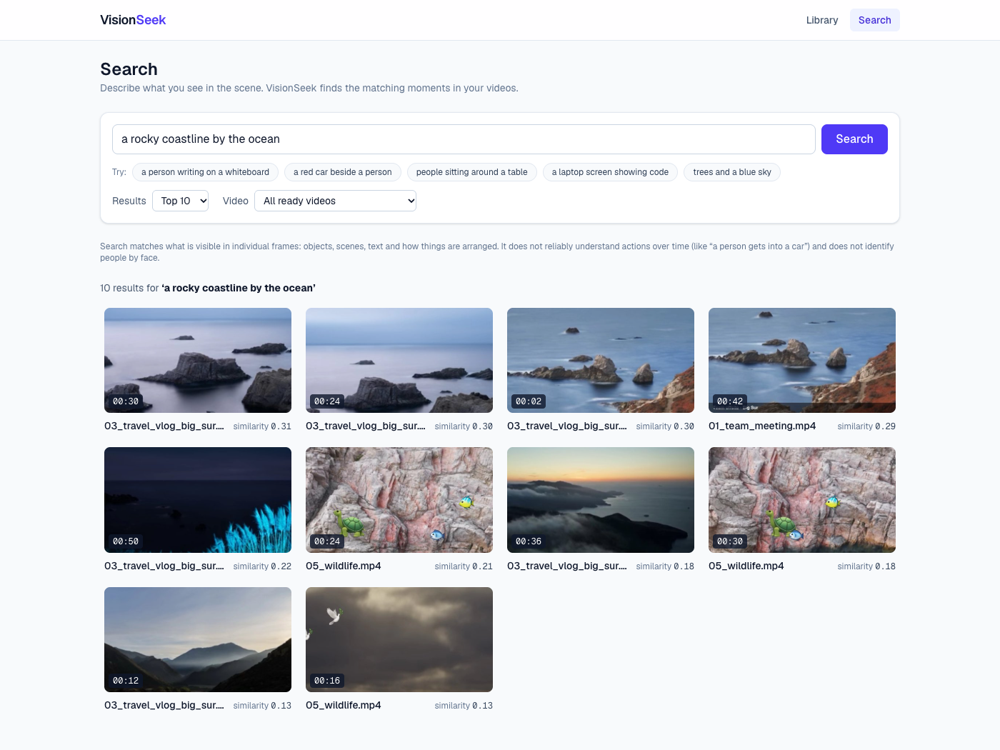
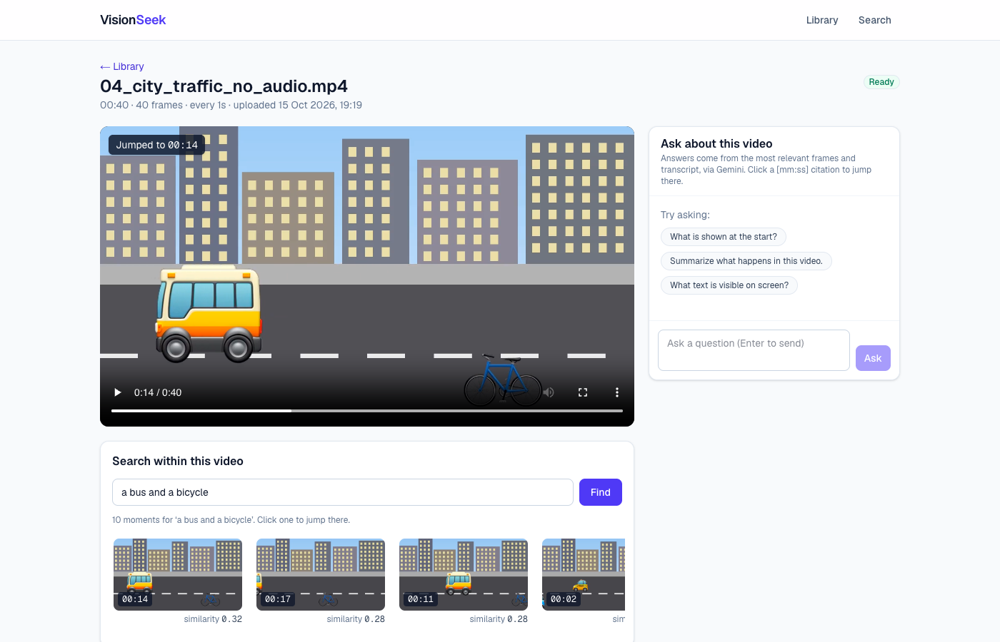
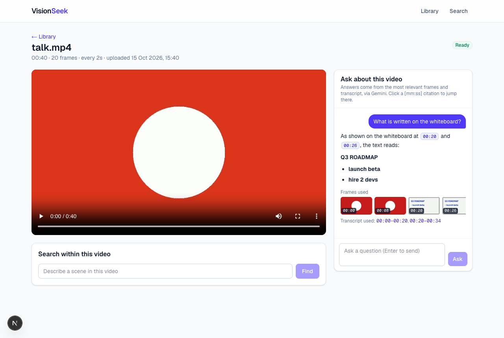
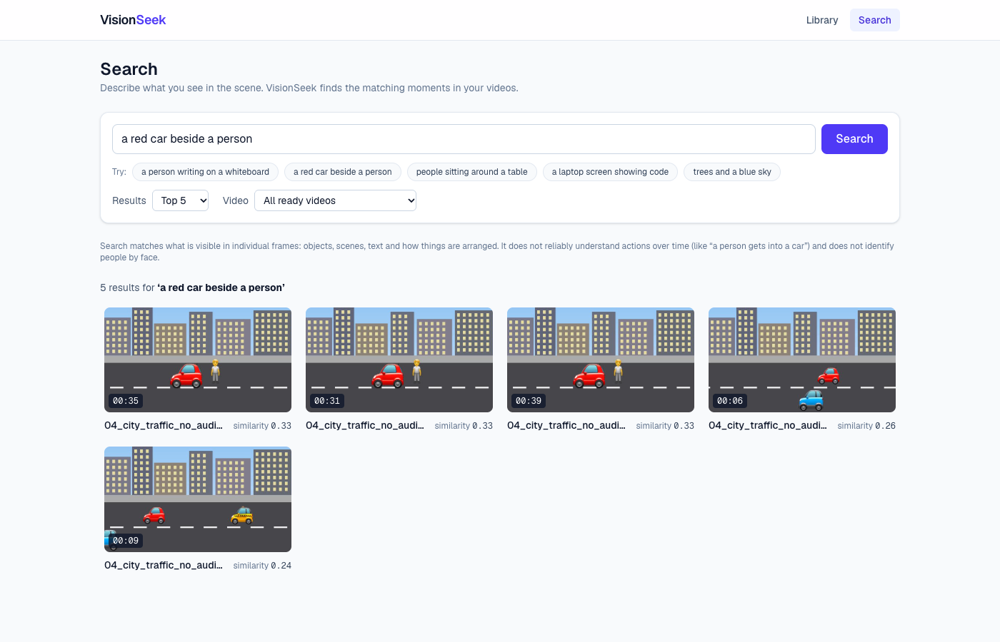
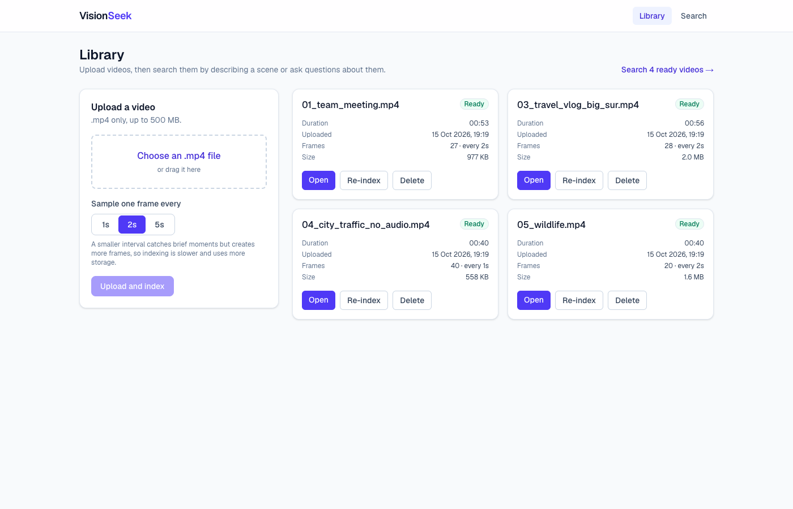
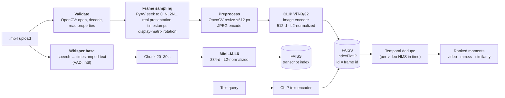
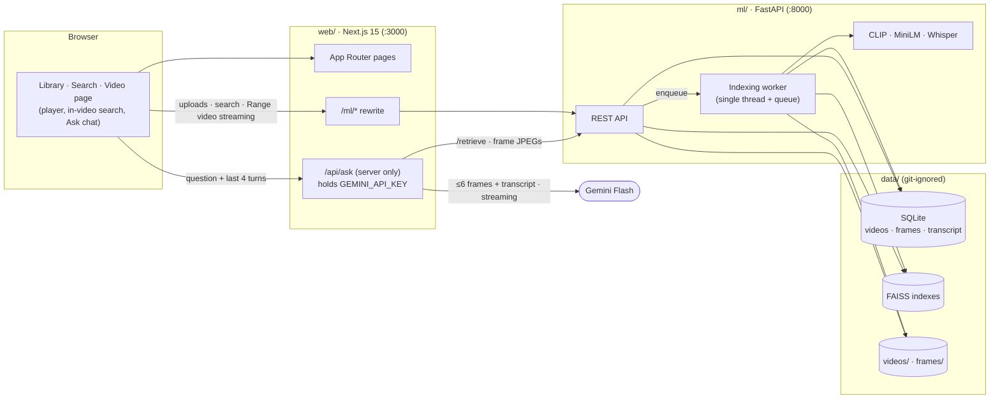
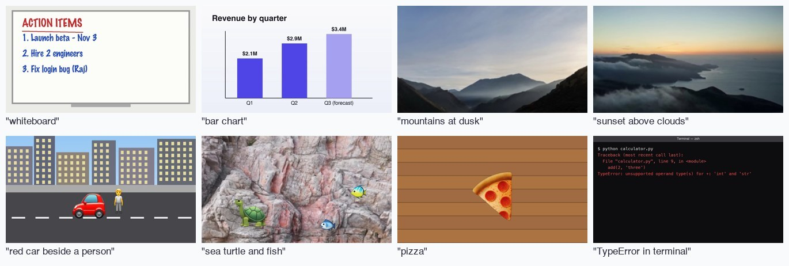

<div align="center">

# 🔎 VisionFind

**Describe the scene, find the moment.**<br/>
Semantic video search and visual question answering for your own videos, built with OpenCV, PyAV, CLIP, FAISS, Whisper and Gemini.




*Typing "a rocky coastline by the ocean" returns matching frames from **two different videos**, ranked by CLIP similarity. Click one to jump straight to that moment.*

</div>

---

## Contents

- [What it does](#what-it-does)
- [The computer vision and deep learning pipeline](#the-computer-vision-and-deep-learning-pipeline)
- [Architecture](#architecture)
- [Quick start](#quick-start)
- [Using the app](#using-the-app)
- [Test videos and evaluation](#test-videos-and-evaluation)
- [Configuration](#configuration) · [API](#ml-api) · [Tests](#tests)
- [Engineering decisions](#engineering-decisions)
- [Known limitations](#known-limitations) · [Roadmap](#roadmap) · [Project layout](#project-layout)

## What it does

Scrubbing through hours of footage to find "the part where the whiteboard had the action items" is slow. VisionFind indexes each video **once** with computer vision and deep learning models, then lets you search and question it in plain English.

| | Feature | How |
|---|---|---|
| 🔎 | **Text-to-frame visual search** across all your videos | CLIP image and text embeddings in one shared space, with exact cosine search in FAISS. Fully local. |
| 🎯 | **Jump to the exact moment** | Frame-accurate timestamps (even on variable-frame-rate phone and screen recordings). The player seeks to the frame you clicked. |
| 🎞️ | **Search within one video** | The same model, restricted to one video's frames, shown as a clickable timeline strip |
| 💬 | **Ask questions about a video** | Multimodal retrieval (CLIP frames plus Whisper transcript chunks) feeds Gemini Flash, which streams an answer with clickable `[mm:ss]` citations |
| 🙅 | **Honest answers** | If something isn't visible or said in the retrieved material, it says so instead of guessing |
| ⚡ | **Index once, query fast** | Searching never re-processes video: about 15 ms per query on a laptop |

<table>
<tr>
<td width="50%"><br/><sub><b>Video page.</b> "a bus and a bicycle" within one video. Clicking a thumbnail jumped the player to 00:14.</sub></td>
<td width="50%"><br/><sub><b>Ask about this video.</b> Gemini reads the handwritten whiteboard from the retrieved frames and cites <code>[00:20]</code> and <code>[00:26]</code>.</sub></td>
</tr>
<tr>
<td width="50%"><br/><sub><b>Spatial relations in a scene.</b> "a red car beside a person" ranks the right scene first.</sub></td>
<td width="50%"><br/><sub><b>Library.</b> Upload, pick a sampling interval, and watch each video move through the indexing stages.</sub></td>
</tr>
</table>

## The computer vision and deep learning pipeline



### 1. Video decoding and frame sampling (OpenCV + PyAV)
- **Validation.** Every upload must open in **OpenCV** and decode a frame before it's accepted. Corrupt or unreadable files are rejected with a clear message and deleted.
- **Sampling at fixed intervals.** You choose 1, 2 or 5 s, which gives ⌈duration / N⌉ frames. Each sample is found by **seeking** to the nearest preceding keyframe and decoding forward, never by decoding the whole video. When the next sample is close, the decoder simply keeps going instead of seeking again.
- **Frame-accurate timestamps.** OpenCV maps a time to a frame number using the *average* FPS, which is wrong on variable-frame-rate video: in testing a frame labelled 15 s actually came from 20.8 s. VisionFind decodes with **PyAV** and stores each frame's **real presentation timestamp**, so a thumbnail always matches the moment the player jumps to. This is covered by tests with synthetic VFR and sparse-keyframe videos.
- **Orientation.** Phone videos are rotated using the stream's display matrix, the same way ffmpeg does.
- **Preprocessing.** **OpenCV** resizes frames to at most 512 px wide (`INTER_AREA`) and encodes them as JPEG thumbnails.

### 2. Visual embeddings: CLIP (deep learning)
- **Model:** [OpenCLIP](https://github.com/mlfoundations/open_clip) **ViT-B/32**, trained contrastively on LAION-2B (`laion2b_s34b_b79k`). Image and text encoders project into **the same 512-d space**, so a sentence can be compared directly with a frame. That's zero-shot retrieval with no training on your data.
- **Inference:** frames are embedded in batches of 32 on **Apple MPS** or **CUDA** when available, otherwise the CPU. Every vector is **L2-normalized**, so inner product equals cosine similarity.
- **Querying:** text queries go through the **same CLIP model's** text encoder, which is a hard rule in the code.

### 3. Vector search and ranking (FAISS)
- **Index:** `IndexIDMap2(IndexFlatIP)`, an exact search keyed by the **database primary key** of each frame and never by insertion order. Results are mapped back with a SQL join, so a result can't point to the wrong video or timestamp.
- **Over-fetching:** search requests `top_k × 5` candidates, keeps only fully indexed videos, and widens the search automatically if filtering leaves too few.
- **Temporal deduplication:** neighbouring frames of a static shot look almost identical, which would fill the results with one scene. Like non-maximum suppression in object detection, but over time within each video, a result is dropped if a better-ranked one is within 2 × the sampling interval.

### 4. Speech and multimodal retrieval (Whisper + MiniLM + Gemini)
- **ASR:** [faster-whisper](https://github.com/SYSTRAN/faster-whisper) `base` (CTranslate2, int8 on CPU, voice-activity detection). Videos without an audio track are detected and skipped.
- **Chunking:** speech segments are merged into **20–30 s chunks** and embedded with **all-MiniLM-L6-v2** (384-d) in a second FAISS index.
- **Q&A (retrieval-augmented generation):** for a question, VisionFind retrieves the top CLIP frames, the top transcript chunks, and the chunks spoken while those frames were on screen. It sends at most **6 frames (512 px) plus the transcript excerpts** to **Gemini Flash**, which can read images.
  - **Grounded answers:** the system instruction allows only what's visible or said, requires `[mm:ss]` citations, and requires an explicit "not visible or mentioned" when the material doesn't contain the answer.

| Model | Role | Output | Runs on |
|---|---|---|---|
| OpenCLIP ViT-B/32 (LAION-2B) | Frame and query embeddings | 512-d | MPS / CUDA / CPU |
| faster-whisper `base` | Speech recognition | timestamped text | CPU int8 |
| all-MiniLM-L6-v2 | Transcript embeddings | 384-d | MPS / CUDA / CPU |
| Gemini Flash (API) | Visual question answering | streamed text | Google |

## Architecture



**Indexing is a background job.** An upload is validated and queued. A single worker then moves the video through `extracting_frames → embedding → transcribing → building_index → ready`, and a video becomes searchable only after every stage and the index save have finished. On failure, its partial vectors are removed and the card shows a readable error with a **Retry** button.

## Quick start

### Requirements
- **Python 3.11** and **Node.js 20+** on macOS, Linux or Windows
- About **1 GB of disk** for models, downloaded automatically on first use: CLIP (~600 MB), Whisper base (~145 MB), MiniLM (~90 MB)
- A free **Gemini API key** from [Google AI Studio](https://aistudio.google.com/apikey). It's only needed for *Ask*; search works without it.

> **macOS tip:** the quickest way to get Python 3.11 is [uv](https://docs.astral.sh/uv/):
> `curl -LsSf https://astral.sh/uv/install.sh | sh && uv python install 3.11`

### 1. Clone
```bash
git clone https://github.com/Yashvi21/visionfind.git
cd visionfind
```

### 2. ML service (FastAPI, port 8000)
```bash
cd ml
uv venv --python 3.11 .venv                        # or: python3.11 -m venv .venv
uv pip install --python .venv/bin/python -r requirements.txt   # or: .venv/bin/pip install -r requirements.txt
source .venv/bin/activate                          # Windows: .venv\Scripts\activate
uvicorn app.main:app --port 8000
```
Check it with `curl localhost:8000/health`. Interactive API docs are at http://localhost:8000/docs.

### 3. Web app (Next.js, port 3000)
```bash
cd web
npm install
cp .env.example .env.local      # then set GEMINI_API_KEY and GEMINI_MODEL (e.g. gemini-flash-latest)
npm run dev
```
Open **http://localhost:3000**. The browser only talks to Next.js; `/ml/*` is proxied to the ML service, and the Gemini key stays on the server.

### 4. Optional: generate test videos (macOS)
```bash
cd ml && source .venv/bin/activate
python scripts/make_test_videos.py      # -> data/test_videos/ (10 videos + TEST_GUIDE.md + eval_set.json)
```
Upload them from the Library page. `data/test_videos/TEST_GUIDE.md` lists what to search for and which questions to ask, with the expected answers.

## Using the app

1. **Library (`/`).** Upload an `.mp4` (up to 500 MB) and choose a sampling interval. The panel shows the estimated frame count and explains the trade-off: smaller interval, more frames, slower indexing. Cards update live while indexing and offer **Open**, **Re-index** (with a new interval), **Delete** and **Retry**.
2. **Search (`/search`).** Describe a scene, for example *"handwritten notes on a whiteboard"* or *"a red car beside a person"*. Choose Top 5/10/20 and optionally one video. Results show the thumbnail, video, `mm:ss` and **similarity**. The query and settings live in the URL, so searches can be bookmarked and shared.
3. **Video page (`/videos/{id}`).** The player jumps to the clicked moment with a *"Jumped to mm:ss"* label. **Search within this video** shows matches as a timeline strip you can click.
4. **Ask about this video.** Ask *"What are the action items on the whiteboard?"*. The answer streams in with `[mm:ss]` chips that seek the player, the frames and transcript ranges it used, and the last 4 turns as context. Rate limits and overloads show clear "try again in a minute" messages after automatic retries.

## Test videos and evaluation

### A labelled test set
`ml/scripts/make_test_videos.py` builds 10 videos from local resources only: macOS wallpaper photographs, emoji artwork, system fonts and `say` narration. Each one targets a different part of the vision pipeline:



| Video | What it tests |
|---|---|
| Team meeting, product demo, cooking show | Reading slides, charts and handwriting; facts that are only spoken; honest "not mentioned" answers |
| Travel vlog, wildlife | Retrieval on real photographs; objects on natural backgrounds |
| City traffic (**no audio**) | Moving objects, spatial relations ("a red car beside a person"), skipping transcription |
| Coding screencast and phone video (**variable frame rate**, **portrait**) | Frame-accurate timestamps, on-screen text |
| 5-minute lecture | Long indexing, many transcript chunks |
| Old **MPEG-4 Part 2** file | Indexed by OpenCV/PyAV but not playable in Chrome; the UI explains instead of breaking |

### Metrics
`ml/scripts/evaluate.py` indexes a labelled set at 1, 2 and 5 s intervals in a temporary directory (your library is never touched) and reports frame count, indexing time, index size, **Recall@5**, **MRR@10** and search latency.

```bash
cd ml && source .venv/bin/activate
python scripts/evaluate.py --eval-set ../data/test_videos/eval_set.json   # the generated test set
python scripts/evaluate.py                                                 # built-in synthetic benchmark
```

Results on the generated test set (10 videos, ~11 min, 47 labelled queries) on an Apple Silicon laptop, CLIP on MPS:

| Interval | Frames | Indexing time (incl. Whisper) | FAISS index | Recall@5 | MRR@10 | Search p50 / p95 |
|---|---|---|---|---|---|---|
| 1 s | 658 | 117 s | 1.3 MB | 0.96 | 0.90 | 15 / 19 ms |
| 2 s | 330 | 54 s | 0.7 MB | 0.96 | 0.89 | 15 / 19 ms |
| 5 s | 135 | 43 s | 0.3 MB | 0.98 | 0.90 | 15 / 18 ms |

Takeaways:
- **Search latency is flat** across intervals, because exact FAISS search over thousands of vectors is trivial.
- **Indexing time is dominated by Whisper** at coarse intervals and by CLIP at fine ones.
- **Misses** are on visually similar slides; for example, "a comet" sometimes ranks other dark lecture slides higher. These are generated scenes: label a few of your own videos for real-world numbers (format in `ml/scripts/eval_set.example.json`).

## Configuration

| Variable | Where | Default | Meaning |
|---|---|---|---|
| `GEMINI_API_KEY` | `web/.env.local` | (required for Ask) | Server-side only; never sent to the browser |
| `GEMINI_MODEL` | `web/.env.local` | (required for Ask) | A Flash model from AI Studio, e.g. `gemini-flash-latest` |
| `ML_URL` | `web/.env.local` | `http://localhost:8000` | Where Next.js reaches the ML service |
| `VS_DATA_DIR` | ML env | `../data` | Videos, frames, indexes, SQLite |
| `VS_MAX_UPLOAD_MB` | ML env | `500` | Upload limit; the UI reads it from `/health` |
| `VS_DEVICE` | ML env | auto | Force `cpu` / `mps` / `cuda` for CLIP and MiniLM |
| `VS_WHISPER_MODEL` | ML env | `base` | faster-whisper model size |
| `VS_PRELOAD_MODELS` | ML env | `1` | Load models at startup so the first request is fast |
| `VS_LOG_LEVEL` | ML env | `INFO` | Python log level |

## ML API

| Method | Path | Purpose |
|---|---|---|
| GET | `/health` | Liveness, upload limit, allowed intervals |
| POST | `/videos` | Multipart upload (`file`, `sample_interval_sec` = 1, 2 or 5). 400 for an invalid file or interval, 413 if too large. |
| GET | `/videos`, `/videos/{id}` | Status, stage, frame count, errors |
| GET | `/videos/{id}/file` | Video streaming with HTTP Range (seekable) |
| DELETE | `/videos/{id}` | Removes vectors, frames, rows and the file |
| POST | `/videos/{id}/reindex` | Re-run indexing, optionally with a new interval (also used for Retry) |
| GET | `/frames/{id}/image`, `/frames/{id}/base64` | Stored 512 px frame |
| POST | `/search` | `{query, top_k≤50, video_id?, dedupe_window_sec?}` → ranked frames |
| POST | `/retrieve` | `{video_id, question, k_frames=6, k_chunks=4}` → frames + transcript chunks for Q&A |

## Tests

```bash
cd ml && source .venv/bin/activate && pytest   # 75 tests, deterministic fake models, ~5 s
cd ml && .venv/bin/pytest -m slow              # real CLIP: text and image share one embedding space
cd web && npm test                             # Gemini retries, backoff, timeouts (10 tests)
```

The suite covers:
- **Upload validation.**
- **Frame counts** per interval.
- **Frame-timestamp accuracy**, including variable frame rate, sparse keyframes and rotation.
- **FAISS id to database row mapping.**
- **Search never returns** non-ready or deleted videos.
- **Temporal dedupe.**
- **Index save and reload**, and startup reconciliation.
- **Transcription chunking** and `/retrieve`.

Fake models whose embeddings encode a frame's brightness let tests assert *exactly* which frame and timestamp comes back.

## Engineering decisions

- **One embedding model for frames and queries, always L2-normalized.** Cosine similarity is only meaningful in a shared, normalized space.
- **FAISS id = SQLite primary key.** `add_with_ids` with `AUTOINCREMENT` keys means ids are never reused, and results are resolved by key and never by position.
- **"Ready" means fully indexed.** Search and retrieval join on `status = ready`. On startup a reconciliation step drops vectors that don't belong to a ready video and re-indexes ready videos whose vectors are missing.
- **Indexing never runs in a request handler.** A queue plus one worker thread does it, and deleting a video mid-indexing discards the worker's partial work.
- **PyAV for timing, OpenCV for pixels.** Exact presentation timestamps come from PyAV; validation, resizing and JPEG encoding use OpenCV.
- **Bounded waiting on Gemini.** Retries cover 429/503 with backoff (1, 2, 4 s), each attempt gets 45 s to start answering, and there's an overall deadline of about 90 s, because under load the API can accept a request and never respond.
- **macOS OpenMP quirk.** torch and faiss bundle separate OpenMP runtimes that crash together on macOS, so `OMP_NUM_THREADS=1` is set at startup. CLIP runs on MPS and Whisper gets explicit CPU threads, so speed is unaffected.

## Known limitations

- **Frame-level semantics only.** It matches what is visible in individual frames: objects, scenes, colours, layout and large text. It does not reliably understand **actions over time** ("a person gets into a car"), counting, or fine-grained relations, and it does **not identify people by face**.
- **Sampling can miss brief moments** shorter than the interval. Temporal dedupe hides near-duplicate neighbours; use `dedupe_window_sec: 0` to see all of them.
- **Ask sees only what was retrieved:** at most 6 frames plus a few transcript chunks, so answers can be incomplete. Follow-up questions retrieve on the current question only.
- **Whisper `base` mishears words** (in testing, "hire" became "higher"). Long videos take a while to transcribe on CPU.
- **Privacy:** search is fully local, but *Ask* sends up to 6 frames and transcript excerpts to Google's Gemini API. The free tier has per-minute and per-day limits.
- **Browser codecs:** anything OpenCV and PyAV can decode gets indexed, but browsers can't play every codec (e.g. MPEG-4 Part 2, and often HEVC in Chrome). The player says so; re-encode to H.264.
- **Single machine, single user:** no authentication; one indexing worker; exact (flat) FAISS search, which is fine up to roughly hundreds of thousands of frames.

## Roadmap

- [ ] Hybrid search: CLIP frames + transcript text on the Search page
- [ ] Better follow-up retrieval using conversation context
- [ ] OCR for on-screen text (slides, code, signs)
- [ ] Larger models (CLIP ViT-L/14, Whisper `small`), compared with `evaluate.py`
- [ ] Shot-boundary detection for smarter sampling than fixed intervals
- [ ] Parallel indexing and an approximate FAISS index (IVF/HNSW) for large libraries
- [ ] Authentication and multi-user libraries

## Project layout

```
VisionFind/
├── ml/                          FastAPI service (Python 3.11)
│   ├── app/
│   │   ├── main.py              App startup: DB, FAISS load + reconcile, worker, model preload
│   │   ├── video_io.py          OpenCV validation · PyAV frame-accurate sampling · resize/rotate
│   │   ├── embeddings.py        OpenCLIP ViT-B/32 image/text encoders (MPS/CUDA/CPU)
│   │   ├── transcribe.py        faster-whisper ASR · 20–30 s chunking · MiniLM embeddings
│   │   ├── vector_index.py      Thread-safe FAISS IndexIDMap2(IndexFlatIP) wrapper
│   │   ├── search.py            Ranking, temporal dedupe, Q&A retrieval
│   │   ├── worker.py            Background indexing pipeline
│   │   └── routes/              /videos /frames /search /retrieve /health
│   ├── scripts/
│   │   ├── evaluate.py          Recall@5 · MRR@10 · latency · index size
│   │   └── make_test_videos.py  Labelled test-video generator (macOS)
│   └── tests/                   pytest suite
├── web/                         Next.js 15 · TypeScript · Tailwind
│   ├── app/                     Library, Search, Video pages + /api/ask (Gemini, server only)
│   ├── components/              Player, result cards, Ask chat with citation chips
│   ├── lib/                     API client, Gemini prompt + retry logic
│   └── tests/                   node:test suite
├── docs/images/                 Screenshots used in this README
└── data/                        Runtime storage (git-ignored)
```

## Acknowledgements

[OpenCV](https://opencv.org/) · [PyAV](https://pyav.org/) · [OpenCLIP](https://github.com/mlfoundations/open_clip) and [LAION](https://laion.ai/) · [FAISS](https://github.com/facebookresearch/faiss) · [faster-whisper](https://github.com/SYSTRAN/faster-whisper) / [OpenAI Whisper](https://github.com/openai/whisper) · [Sentence-Transformers](https://www.sbert.net/) · [Google Gemini](https://ai.google.dev/) · [FastAPI](https://fastapi.tiangolo.com/) · [Next.js](https://nextjs.org/)
